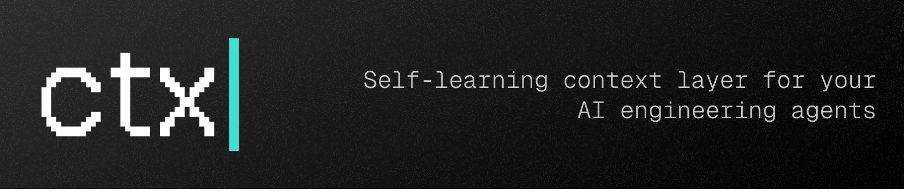
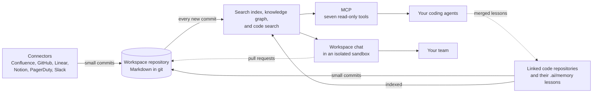

<p align="center">
  
</p>

<p align="center">
  <a href="LICENSE"></a>
  <a href="https://x.com/ctxpipe"></a>
  <a href="https://ctxpipe.ai/discord"></a>
</p>

<p align="center">
  <a href="https://ctxpipe.ai/early-access">Get early access</a>
  ·
  <a href="https://docs.ctxpipe.ai">Docs</a>
  ·
  <a href="https://docs.ctxpipe.ai/docs/self-hosting">Self-host</a>
  ·
  <a href="https://github.com/ctxpipe-ai/ctxpipe/issues">Issues</a>
</p>

# ctx| (ctxpipe)

**Self-learning context infrastructure for AI engineering agents.**

ctx| gives coding agents the context they are missing: how your platform is
structured, which decisions already exist, what standards your team follows, and
how your organization does its work. ctx| keeps that context as Markdown in a
git repository that you own. It reads your code and your tools, and it keeps the
context current with small commits that you can review. Your agents read the
context through one MCP connection.

Use the open-source core yourself, or get in touch for early access to the
managed SaaS at [ctxpipe.ai](https://ctxpipe.ai/early-access).

## What ctx| does

- **Portable context.** Every agent, repository, session, and tool reads the
  same context.
- **Reviewable context.** Instructions, decisions, and skills are Markdown in
  git. Your team reviews each change as a commit or a pull request.
- **Context that learns.** Agents save lasting lessons in `.ai/memory` in each
  repository. After a pull request merges in a linked repository, ctx| reads
  those lessons as instructions for your team.
- **Self-host or managed.** Run the open-source core in your own environment,
  or use the managed SaaS.

## How it works



Each Workspace has one git repository of Markdown knowledge. ctx| commits
connector content and facts from linked code to that repository. After each new
commit, ctx| rebuilds the search index and the knowledge graph. For the full
flow, see [How ctx| works](https://docs.ctxpipe.ai/docs/getting-started/how-it-works).

## Core capabilities

| Capability | What it gives you |
|---|---|
| Git-backed Workspaces | A team's knowledge is Markdown in a git repository that you own. ctx\| keeps it current with small commits that you can review. |
| Cross-repo code search | Agents search all the code repositories that are linked to a Workspace, not only the files that are open in an editor. |
| Product and engineering connectors | ctx\| mirrors the Confluence, GitHub, Linear, Notion, and PagerDuty content that you select into a Workspace as Markdown. It captures a Slack thread when someone mentions the bot. |
| Knowledge graph per Workspace | ctx\| turns the links and claims in knowledge files, and the services, APIs, and libraries in linked code, into a graph that you can explore. |
| One MCP for engineering knowledge | Cursor, Claude Code, Codex, OpenCode, VS Code, and custom tools use the same [MCP](https://docs.ctxpipe.ai/docs/mcp/mcp-docs) endpoint. Seven read-only tools let your agent search knowledge and code, read files, and follow links. |
| Workspace chat | Each conversation gets a coding agent. The agent answers questions about code, systems, and decisions, and it proposes knowledge changes as pull requests. |
| Isolated agent sandboxes | Workspace chat and ingestion run each agent in its own sandbox. A sandbox holds only the repositories and keys that its job needs. |
| Files, Diff, and Graph panes | A Workspace's Files, Diff, and [Graph](https://docs.ctxpipe.ai/docs/workspaces/graph) panes show the context that agents use before they act. |
| Local memory | `npx ctxpipe memory init` adds `.ai/memory` and capture hooks to a repository, for Cursor, Claude Code, Codex, OpenCode, and VS Code. See [Local memory](https://docs.ctxpipe.ai/docs/mcp/local-memory). |

## Coming soon

- Dashboard to see agent activity, patterns, and insights.
- Proactive insights that surface stale context, missing instructions, and useful
  patterns from agent usage.
- More product and engineering connectors (Jira, Figma, and others).

## Get started

### Managed SaaS

The managed SaaS is the fastest path. It includes hosting, connector
credentials, model defaults, and production operations.

**Get early access:** [ctxpipe.ai](https://ctxpipe.ai/early-access)

### Self-host

Teams can run ctx| in their own environment. Use the self-hosting docs as the
deployment runbook, not this README:

- [Self-hosting overview](https://docs.ctxpipe.ai/docs/self-hosting)
- [Quickstart](https://docs.ctxpipe.ai/docs/self-hosting/quickstart)
- [Docker Compose](https://docs.ctxpipe.ai/docs/self-hosting/deployment/docker)
- [Terraform](https://docs.ctxpipe.ai/docs/self-hosting/deployment/terraform)
- [AWS (CDK)](https://docs.ctxpipe.ai/docs/self-hosting/deployment/aws)
- [Production readiness](https://docs.ctxpipe.ai/docs/self-hosting/production-readiness)
- [Upgrades](https://docs.ctxpipe.ai/docs/self-hosting/upgrades)

For the AWS CDK construct, see
[packages/aws-cdk/README.md](packages/aws-cdk/README.md).

### Connect your coding agent

Run the `ctxpipe` CLI in your repository:

```bash
npx ctxpipe init
```

The wizard writes the ctx| MCP config for Cursor, Claude Code, Codex, OpenCode,
or VS Code. It can also add local memory. For local memory only, run
`npx ctxpipe memory init`. See [packages/cli/README.md](packages/cli/README.md).

### Local development

**Requirements:** Node.js 22+, pnpm 10, Bun 1.4.2+, Docker with Compose v2.

```bash
pnpm install
cp apps/backend/.env.example apps/backend/.env.local
# Set AUTH_SECRET, at least 32 characters, in apps/backend/.env.local
# Set MODEL_PROVIDER_API_KEY for Workspace chat and ingestion
# Set AGENT_VAULT_OWNER_PASSWORD (openssl rand -hex 24) for chat sandboxes

pnpm dev:infra
pnpm dev
```

Open [https://app.ctxpipe.localhost](https://app.ctxpipe.localhost).

If your browser warns about the local certificate, run:

```bash
pnpm trust
```

For the model provider settings, see
[Models](https://docs.ctxpipe.ai/docs/self-hosting/models). For the backend API,
OpenAPI, MCP, contract tests, and package scripts, see
[apps/backend/README.md](apps/backend/README.md).

## Documentation

- [Product docs](https://docs.ctxpipe.ai)
- [Getting started](https://docs.ctxpipe.ai/docs/getting-started)
- [How ctx| works](https://docs.ctxpipe.ai/docs/getting-started/how-it-works)
- [Workspaces](https://docs.ctxpipe.ai/docs/workspaces)
- [Connections](https://docs.ctxpipe.ai/docs/connections)
- [MCP setup](https://docs.ctxpipe.ai/docs/mcp/mcp-docs)
- [Local memory](https://docs.ctxpipe.ai/docs/mcp/local-memory)
- [Self-hosting](https://docs.ctxpipe.ai/docs/self-hosting)
- [CLI](packages/cli/README.md)

## Repository layout

| Path | Purpose |
|---|---|
| `apps/backend` | Hono API, auth, MCP endpoint, connectors, workflows, and migrations. |
| `apps/ui` | Product web app. |
| `apps/docs` | Fumadocs documentation site. |
| `apps/codesearch` | Zoekt-backed clone and code search service. |
| `apps/otel-collector` | OpenTelemetry Collector for local development (Compose `infra` profile only). A self-hosted deployment can export with `OTEL_EXPORTER_OTLP_*`. |
| `apps/forge-ctxpipe-agent` | Reference Atlassian Forge app manifest for the Confluence connector. |
| `packages/aws-cdk` | AWS CDK construct for self-hosting ctx\| on AWS. |
| `packages/cli` | The `ctxpipe` CLI: MCP setup (`npx ctxpipe init`) and local memory. |
| `plugins/ctxpipe` | Claude plugin for the hosted ctx\| MCP. |
| `shared` | Git helpers that the backend and codesearch both use. |
| `ops/observability` | Internal ClickStack and Langfuse project. It is not part of a product deploy. |
| `examples/aws-cdk-self-host` | Runnable AWS CDK self-hosting example. |
| `infra` | Terraform for the managed Railway and Neon deployment path. |
| `.ai/memory` | Architecture decisions and project memory used by coding agents. |

## Common commands

| Command | Purpose |
|---|---|
| `pnpm dev:infra` | Start Docker-backed dependencies for local development. |
| `pnpm dev` | Run backend and UI on the host, with codesearch in Docker. |
| `pnpm dev:docs` | Run the docs site on `http://localhost:3003`. |
| `pnpm start` | Run the full containerized stack with the Compose `deploy` profile. |
| `pnpm db:migrate` | Run backend database migrations. |
| `pnpm build` | Build the monorepo with Turborepo. |
| `pnpm lint` / `pnpm format` | Run Biome. |
| `pnpm mcp:inspect` | Open the MCP inspector for the backend. |
| `pnpm mcpjam:inspect --url <mcp-url> --oauth` | Open the pinned MCPJam Inspector against an MCP endpoint. |
| `pnpm mcpjam:doctor --url <mcp-url>` | Probe an MCP endpoint and capture transport/OAuth diagnostics. |
| `pnpm changeset` | Create a Changesets entry for publishable package changes. |
| `pnpm release` | Build and publish release-ready packages. |

## Support and contributing

- Product or early access questions: [ctxpipe.ai](https://ctxpipe.ai)
- Docs and setup questions: [docs.ctxpipe.ai](https://docs.ctxpipe.ai)
- Bugs and feature requests: [GitHub issues](https://github.com/ctxpipe-ai/ctxpipe/issues)
- Community chat: [Discord](https://ctxpipe.ai/discord)
- Technical context for agents: [AGENTS.md](AGENTS.md)

We welcome issues and pull requests. For a large change, open an issue first so
that we can agree on the design and the product direction.

## License

ctx| uses the **MIT License**. See [LICENSE](LICENSE) for the binding terms.
For more about the open-source core, see the
[open-source guide](https://docs.ctxpipe.ai/docs/resources/open-source).
