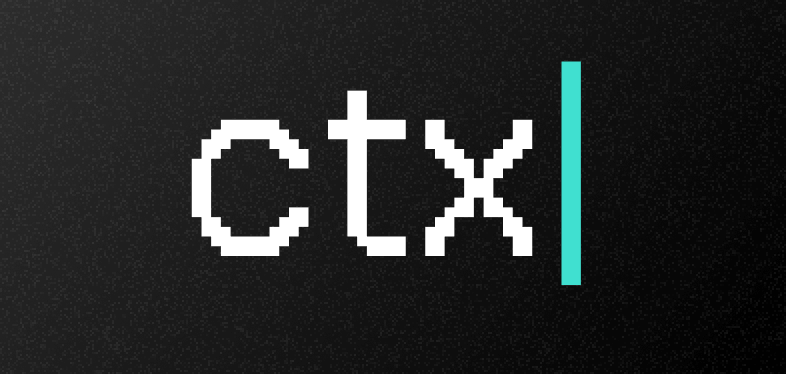
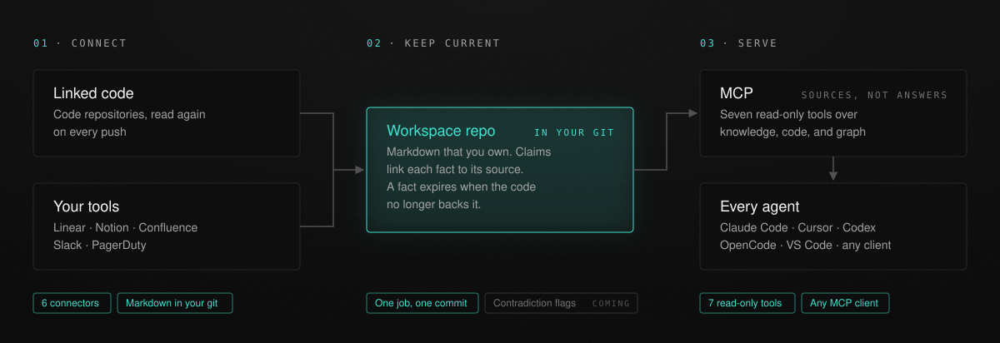
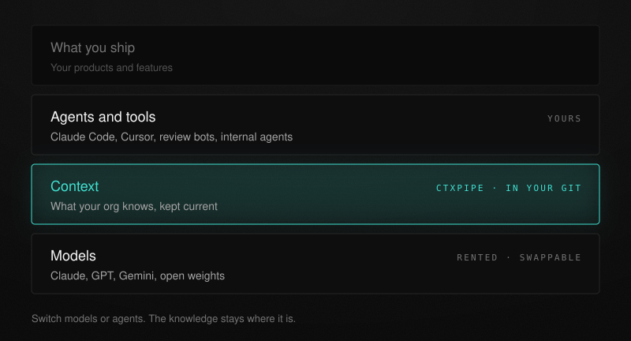

<p align="center">
  
</p>

<p align="center">
  <a href="LICENSE"></a>
  <a href="https://x.com/ctxpipe"></a>
  <a href="https://ctxpipe.ai/discord"></a>
</p>

<p align="center">
  <a href="https://ctxpipe.ai/early-access">Request early access</a>
  ·
  <a href="https://cal.com/ctxpipe/30min">Book a demo</a>
  ·
  <a href="https://docs.ctxpipe.ai">Docs</a>
  ·
  <a href="https://docs.ctxpipe.ai/docs/self-hosting">Self-host</a>
  ·
  <a href="https://github.com/ctxpipe-ai/ctxpipe/issues">Issues</a>
</p>

# ctxpipe

**Context management for software factories.** Open source, MIT licensed.

Your agents can reach everything, but they cannot tell what is true. ctxpipe
turns your code, tickets, docs, and incidents into one organized, current git
repository of Markdown that you can inspect. Background jobs keep it current,
and every coding agent reads it over MCP. Self-host the open-source core, or use
the hosted version ([early access](https://ctxpipe.ai/early-access)).

## The problem

Every repository, ticket, doc, incident, and Slack thread is one MCP call away.
Thus agents read too much, trust the wrong parts, and you cannot see why. More
context has not made the fleet better. It has made the fleet noisier.

- **Too much.** The context window fills with reading, not work.
- **Too noisy.** Stale runbooks, duplicate docs, and decisions that contradict
  each other all look equally true to an agent.
- **Unorganized.** Knowledge is spread across tools and many repositories.
  Nothing links a decision to the code that it governs.
- **Opaque.** When an agent makes a mistake, you cannot see what it read or why
  it believed it.

## How it works

Write it down once. Keep it current. Serve it to every agent.

<p align="center">
  
</p>

1. **Connect: agents read your decisions, not only your code.** Link your code
   repositories, and select what to pull from Linear, Notion, Confluence, Slack,
   and PagerDuty. ctxpipe writes it to one git repository as Markdown, with
   links back to the code. Each team or product gets its own Workspace.
2. **Keep current: agents stop acting on stale docs.** ctxpipe reads a linked
   repository again on every push. Each fact links back to its source. A fact
   expires when the code no longer backs it. Each job makes one commit that you
   can revert.
3. **Serve: every agent starts from the same facts.** Claude Code, Cursor,
   Codex, OpenCode, and VS Code search the same Workspace over MCP: knowledge,
   code, and graph. ctxpipe returns sources, not answers. Your agent reasons
   with its own model and cites the sources.

For the full flow, see
[How ctxpipe works](https://docs.ctxpipe.ai/docs/getting-started/how-it-works).

## Where ctxpipe fits

Same models as everyone else. Your factory is the difference.

<p align="center">
  
</p>

Teams that scale with AI build a harness around the models: agents, review
bots, and internal tools. Under all of it is what your organization knows about
how you build. Most teams make that layer by hand, and it goes stale when its
maintainer moves on. ctxpipe is that layer: open source, and kept in your own
repository.

## Designed for transparency

Nothing that your agents read is hidden from you.

- **It is open source.** The core is MIT licensed, including every job that
  writes to your Workspace. Read it, run it, or fork it.
- **Context is files in a repository.** Every fact that your agents read is a
  Markdown file in a git repository that you own. Open it in any editor, or
  point any tool at it.
- **History is git.** Every change is a commit that you can read, blame, or
  revert. Jobs commit small and often. Workspace chat edits arrive as pull
  requests.
- **The knowledge stays with you.** If you stop using ctxpipe, the Workspace
  repository stays where it is, with its full history.

## Features

| Feature | What it does |
|---|---|
| Git-backed Workspaces | One Markdown repository per team or product, in your git. |
| Six connectors | GitHub, Linear, Notion, Confluence, PagerDuty, and Slack. |
| Background upkeep | Reads code on every push, and expires facts that lose their source. |
| Knowledge graph | Typed links between facts, code, and their sources. |
| Inspectable views | Files, Diff, Graph, and the history of every commit. |
| Workspace chat | Answers with sources, and proposes changes as pull requests. |
| One MCP endpoint | Seven read-only tools that return sources, not answers. |
| Scoped access | Read-only, and limited to the organizations that you approve. |
| Isolated sandboxes | Each agent holds only the repositories and keys that it needs. |
| Self-hosting | Docker Compose, Terraform, or AWS CDK. |

## Get started

### Hosted (early access)

We operate ctxpipe for you. We help you set up your first Workspace, connect
GitHub and your tools, and connect your agents to it. Model calls go only to
zero-data-retention endpoints, and ctxpipe does not train on your code.

[Request early access](https://ctxpipe.ai/early-access), or
[book a demo](https://cal.com/ctxpipe/30min).

### Self-host

The MIT core runs on Docker Compose for evaluation, and on Terraform or AWS CDK
in production. It works with any OpenAI-compatible model provider, including
Azure and Bedrock. When you self-host, the servers of ctxpipe are not in the
data path. Use the self-hosting docs as the deployment runbook, not this README:

- [Self-hosting overview](https://docs.ctxpipe.ai/docs/self-hosting)
- [Quickstart](https://docs.ctxpipe.ai/docs/self-hosting/quickstart)
- [Docker Compose](https://docs.ctxpipe.ai/docs/self-hosting/deployment/docker)
- [Terraform](https://docs.ctxpipe.ai/docs/self-hosting/deployment/terraform)
- [AWS (CDK)](https://docs.ctxpipe.ai/docs/self-hosting/deployment/aws)
- [Production readiness](https://docs.ctxpipe.ai/docs/self-hosting/production-readiness)
- [Upgrades](https://docs.ctxpipe.ai/docs/self-hosting/upgrades)

For the AWS CDK construct, see
[packages/aws-cdk/README.md](packages/aws-cdk/README.md).

### Connect your coding agent

Run the `ctxpipe` CLI in your repository:

```bash
npx ctxpipe init
```

The wizard writes the ctxpipe MCP config for Claude Code, Cursor, Codex,
OpenCode, or VS Code. Any other MCP client can use the same endpoint. The wizard
can also add [local memory](https://docs.ctxpipe.ai/docs/mcp/local-memory):
Markdown lessons in `.ai/memory` that your agents keep with the code. For local
memory only, run `npx ctxpipe memory init`. See
[packages/cli/README.md](packages/cli/README.md).

## Documentation

- [Product docs](https://docs.ctxpipe.ai)
- [Getting started](https://docs.ctxpipe.ai/docs/getting-started)
- [How ctxpipe works](https://docs.ctxpipe.ai/docs/getting-started/how-it-works)
- [Workspaces](https://docs.ctxpipe.ai/docs/workspaces)
- [Connections](https://docs.ctxpipe.ai/docs/connections)
- [MCP setup](https://docs.ctxpipe.ai/docs/mcp/mcp-docs)
- [Local memory](https://docs.ctxpipe.ai/docs/mcp/local-memory)
- [Self-hosting](https://docs.ctxpipe.ai/docs/self-hosting)
- [CLI](packages/cli/README.md)

## Support and contributing

- Product or early access questions: [ctxpipe.ai](https://ctxpipe.ai), or [book a demo](https://cal.com/ctxpipe/30min)
- Docs and setup questions: [docs.ctxpipe.ai](https://docs.ctxpipe.ai)
- Bugs and feature requests: [GitHub issues](https://github.com/ctxpipe-ai/ctxpipe/issues)
- Community chat: [Discord](https://ctxpipe.ai/discord)

To contribute, see [CONTRIBUTING.md](CONTRIBUTING.md). It covers local
development, the repository layout, and the common commands.

## License

ctxpipe uses the **MIT License**. See [LICENSE](LICENSE) for the binding terms.
For more about the open-source core, see the
[open-source guide](https://docs.ctxpipe.ai/docs/resources/open-source).
